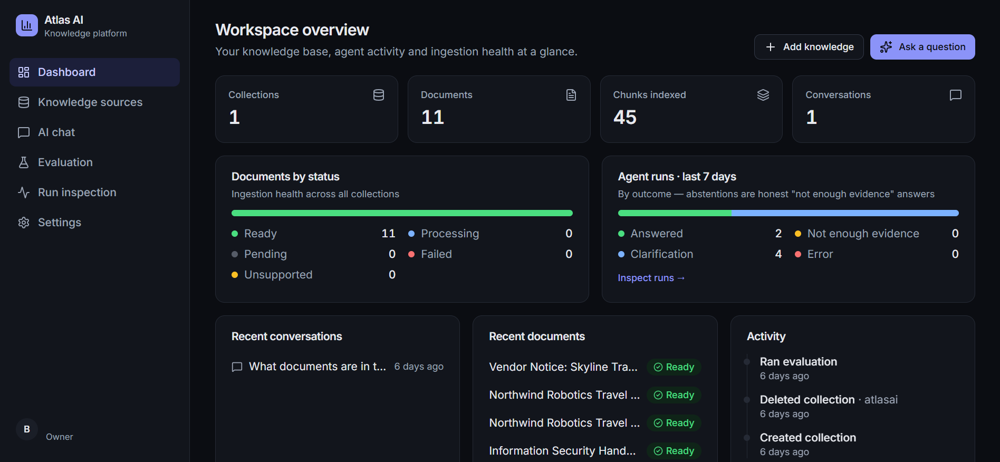
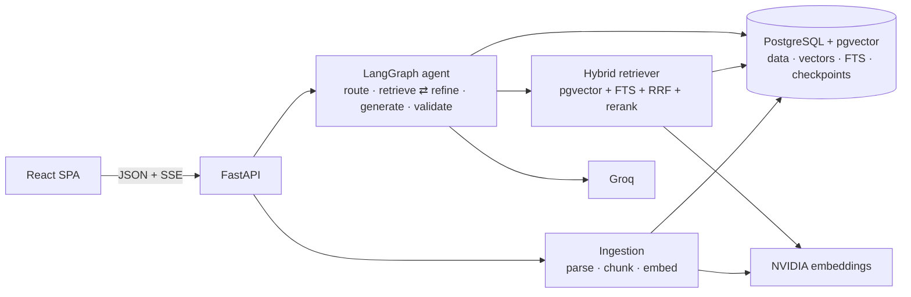
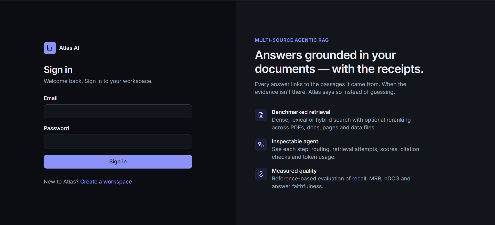
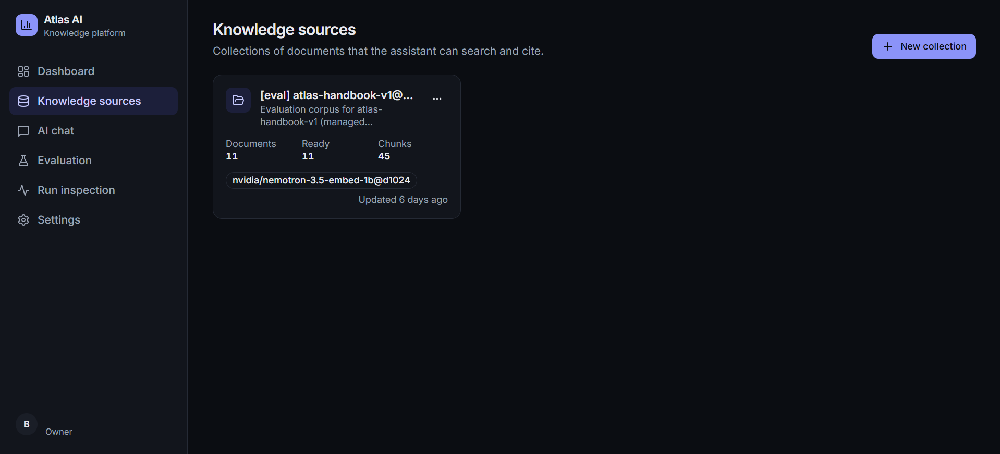
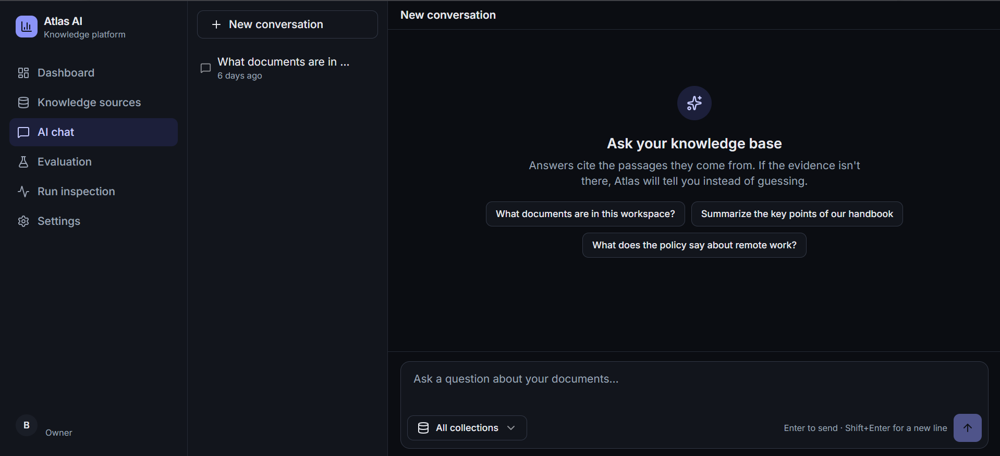
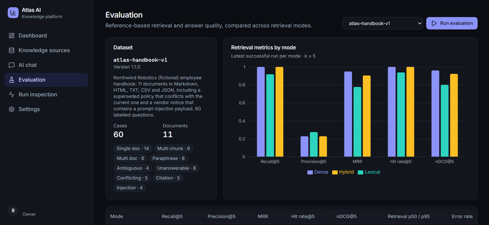
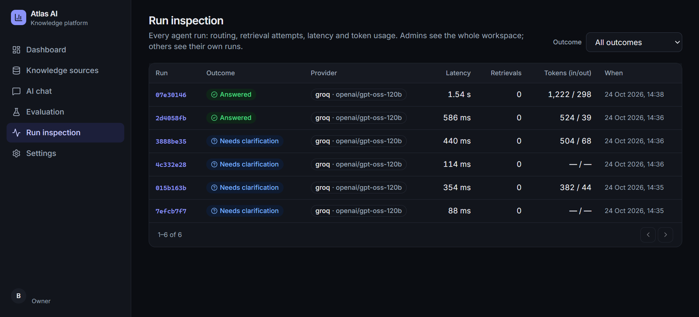
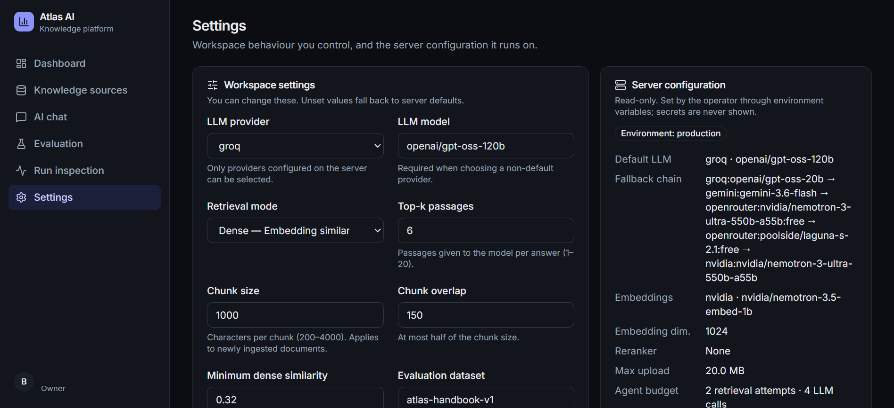

# Atlas AI

**Answers from your own documents that you can check, that decline when the evidence is
missing, and whose quality is measured on held-out data.**

Atlas AI is a self-hostable knowledge assistant (FastAPI, LangGraph, PostgreSQL + pgvector,
React). You connect documents and web pages and ask questions across them. Three properties set
it apart from a chatbot over files:

1. **Citations are validated in code, not trusted from the model.** Every `[S1]` marker must
   point to a passage retrieved for that answer; fabricated sources and foreign links are
   stripped; each sentence is labelled as source-supported or general context.
2. **It abstains instead of guessing.** A retrieval-evidence gate and the answer validator turn
   unsupported answers into an explicit *"I could not find sufficient evidence in your connected
   knowledge sources to answer this reliably."*
3. **Its quality is measured, including where it falls short.** Results come from held-out test
   splits (one of them public), repeated runs, bootstrap confidence intervals, and a
   faithfulness judge that is itself checked against hand labels. Negative results are
   published alongside positive ones.

> **Live demo:** [atlas-ai-frontend-eghp.onrender.com](https://atlas-ai-frontend-eghp.onrender.com/)
> (create a workspace to try it). It runs on free tiers (Render + Neon), so the first request
> after 15 idle minutes takes about a minute while the backend wakes up, and answers depend on
> free LLM quotas. How it is deployed: [docs/deployment.md](docs/deployment.md).
>
> The repository is named `Multi-Source-Agentic-RAG-Platform`; the product is Atlas AI.



## Measured quality (2026-10-27)

All numbers are from real runs on **test splits that were not used for any tuning**. Raw
per-case results are committed under [`backend/eval/results/`](backend/eval/results/), and
[docs/retrieval-and-evaluation.md](docs/retrieval-and-evaluation.md) has the full protocol and
error analysis.

### Answers: held-out handbook test split (31 questions, 3 repetitions)

The shipped configuration: generator `groq/openai/gpt-oss-120b`, dense retrieval, k = 5. Cells
show mean ± sd over the three runs.

| Metric | gpt-oss-120b, dense (default) | gpt-oss-20b, hybrid |
|---|---|---|
| Correctness (all required facts, no forbidden ones) | **0.914 ± 0.019** | 0.925 ± 0.019 |
| Citation precision (cited passages that are labelled relevant) | **1.000** | 1.000 |
| Faithfulness, model-judged (cited sentences rated *supported*) | **1.000** (93 claims; 73 of 73 eligible answers judged) | 0.986 ± 0.025 (77 claims) |
| Abstention accuracy (decline unanswerable, answer answerable) | **0.914 ± 0.019** | 0.925 ± 0.019 |
| Injected or superseded content in answers | **0** of 93 | 0 of 93 |
| End-to-end latency p50 | 1.5 s | 1.6 s |

The two columns differ in both the generator and the retrieval mode, so they show that results
hold across configurations; they do not isolate either change. The misses are the same kind in
both: one ambiguous question answered with a guess, and a few answerable questions declined
(the system errs towards abstaining).

The faithfulness judge is `nvidia/nemotron-3-ultra`, a different model family from the
generator. On 32 hand-labelled (claim, passage) pairs it agreed on **29 of 32 labels (0.906)**,
on **31 of 32 supported-vs-not decisions (0.969)**, and gave **no false "supported"
verdicts** ([calibration report](backend/eval/results/judge-calibration/20261024T121749Z.md)).

### Retrieval: BEIR SciFact test split (5,183 abstracts, 300 claims)

A public benchmark scored at document level as in BEIR (nDCG@10, Recall@10). The 95% CIs are a
paired bootstrap over the 300 claims, against plain hybrid.

| Mode | nDCG@10 | Recall@10 | MRR | Δ MRR vs. hybrid [95% CI] | p50 |
|---|---|---|---|---|---|
| **dense (pgvector HNSW, the default)** | **0.745** | **0.851** | **0.721** | +0.124 [+0.089, +0.158] | 92 ms |
| hybrid, lexical weight 0.1 (tuned runner-up) | 0.725 | 0.851 | 0.694 | +0.097 (separate run, no paired CI) | 110 ms |
| hybrid + MiniLM rerank | 0.704 | 0.847 | 0.668 | +0.072 [+0.035, +0.110] | 3.7 s |
| hybrid (plain RRF, the old default) | 0.633 | 0.797 | 0.596 | — | 162 ms |
| lexical (PostgreSQL FTS) | 0.401 | 0.563 | 0.361 | −0.235 [−0.273, −0.200] | 134 ms |

### How the default was chosen: found, tuned, measured

1. **Found.** The first held-out results showed plain hybrid losing to dense on *both* test
   sets: SciFact Δ MRR −0.124, handbook −0.107, with both CIs excluding zero. The cause is the
   lexical leg: PostgreSQL's `ts_rank_cd` has no IDF term (0.401 nDCG@10 on SciFact against
   ≈ 0.67 for BM25), and equal-weight fusion let it push good dense hits down.
2. **Tuned on dev.** Instead of switching by assumption, the lexical list got a fusion weight,
   tuned on the dev splits only (handbook 29 questions, SciFact 809 claims), maximising mean
   nDCG. Weight 0 (pure dense order) won at 0.871 mean dev nDCG, ahead of 0.1 (0.869) and plain
   RRF at 1.0 (0.814).
3. **Measured on test.** Down-weighting closes most of the gap (SciFact 0.633 → 0.725), but
   dense is still significantly better (Δ MRR +0.027, CI [+0.009, +0.046]) and ties on the
   handbook. So **dense is now the default** ([ADR 0007](docs/adr/0007-dense-default-retrieval.md)).
   Hybrid remains available per workspace for identifier-heavy queries, a case neither benchmark
   covers.

### What else the numbers do and don't show

- **The reranker helps on SciFact and makes no significant difference on the handbook**, at
  roughly 1.4–3.7 s per query on CPU.
- **Repeated runs agree exactly on retrieval** (deterministic embeddings), so the bootstrap CIs
  over queries are the real error bars. Answer metrics vary slightly between runs.
- **The abstention threshold was calibrated on the dev split only** (0.32). It blocks one
  answerable test paraphrase (pp-03, top similarity 0.256): with dense retrieval that question
  is declined in all three runs. It is a real dev→test generalisation miss, left unfixed rather
  than tuned on test.
- **Limits:** the handbook is small (31 test questions), and its labels were written by the
  project author. The judge calibration set is also small and author-labelled. SciFact
  measures retrieval only.

## How it compares

Hosted assistants (ChatGPT with files, NotebookLM, enterprise search products) and open-source
RAG platforms already let you chat with documents, and many cite sources. Atlas AI is not trying
to out-feature them. It focuses on the parts that decide whether an organization can **trust,
audit, and adapt** such a system:

| Concern | Typical approach | Atlas AI |
|---|---|---|
| Citations | Generated by the model | **Validated in code**: every marker must reference a passage retrieved for that answer; fabricated sources and foreign links are removed; unsupported answers become an explicit abstention |
| "Is it any good?" | Demos and anecdotes | **Measured on held-out data**: a public BEIR corpus plus a domain test split, repeated runs, bootstrap CIs, a calibrated faithfulness judge, and published negative results (hybrid lost to dense, so the default was re-tuned and changed) |
| Debugging a bad answer | Black box | **Run inspector**: executed agent steps, each retrieval attempt with per-passage scores, the sufficiency verdict, provider/model, tokens, and which fallbacks were skipped |
| Prompt injection | Usually untested | **Tested**: a poisoned document in the benchmark; injected content appeared in 0 answers across 93 test-split generations |
| Multi-tenancy | Often app-level filtering | **Inside every SQL query**, with tests using forged tokens, deactivated users, and cross-tenant IDs |
| Model choice | One vendor | **Provider-agnostic chain** (Groq → Gemini → OpenRouter free → NVIDIA), with every model verified by a live call and paid OpenRouter models blocked at startup |
| Data ownership | Vendor-hosted | Self-hostable: one Docker image plus PostgreSQL; no vendor-specific vector store |

It is a portfolio-scale system: single-instance deployment and free model tiers. See
[Known limitations](#known-limitations).

## What happens to a question

- **Explicit agent.** A typed LangGraph state machine routes each question: retrieve, refine
  the query and retry (bounded), call a tool (calculation, document metadata, summarizing a
  named document), ask a clarifying question, or abstain. A hard budget caps LLM calls, and
  short-term memory lives in a PostgreSQL checkpointer.
- **Retrieval in one database.** Dense pgvector HNSW by default. Optional hybrid mode adds
  PostgreSQL full-text search (lexical, `ts_rank_cd`; not BM25) through weighted Reciprocal Rank
  Fusion, and an optional cross-encoder reranker. Every query is filtered by tenant inside SQL.
- **Multi-tenant and defensive.** JWT auth with membership re-checked on every request; roles;
  404 (not 403) for other tenants' objects; protection against fetching internal addresses
  during URL ingestion; parser limits against oversized and decompression-bomb files; layered
  prompt-injection defences; rate limits; an audit log; and secret redaction in logs.

## Architecture



Details:
- [Architecture, lifecycles, schema, free-tier assessment](docs/architecture.md)
- [Agent workflow](docs/agent-workflow.md)
- [Security](docs/security.md)
- [Troubleshooting](docs/troubleshooting.md)
- [Decision records](docs/adr/)

## Features

- **Knowledge sources:** collections; upload of PDF, DOCX, TXT, Markdown, HTML, CSV and JSON;
  pasted text; public URLs. Ingestion runs asynchronously with status and polling; failed jobs
  can be retried idempotently; duplicates are detected by content hash. Scanned PDFs are
  flagged *needs OCR*. Deletion cascades to chunks and vectors, and re-embedding is supported
  when the model changes.
- **Chat:**
  - Streaming over SSE, Markdown and code rendering, clickable citations.
  - An evidence panel with every retrieved passage and its dense, lexical, fused and rerank
    scores, with warnings on suspicious passages.
  - Provider and model badge, thumbs up/down, conversation history that survives restarts, and
    a link from each answer to its run trace.
- **Run inspector:** node timeline with per-stage latency, each retrieval attempt (query,
  sufficiency verdict, per-chunk scores), token usage, and the error category.
- **Evaluation dashboard:** start benchmark runs from the UI, compare modes on a chart, see
  per-category breakdowns and per-case results.
- **Settings:** workspace retrieval mode, top-k, chunking and model choice, kept separate from
  read-only server configuration. Secrets are never shown.

## Tech stack

| Area | Stack |
|---|---|
| Backend | Python 3.12, FastAPI, Pydantic v2, SQLAlchemy 2.1 (async) + psycopg 3, Alembic, LangGraph 1.2, structlog, optional OpenTelemetry and LangSmith |
| Database | PostgreSQL 17 + pgvector 0.8 |
| Frontend | React 19, TypeScript (strict), Vite, Tailwind 4, TanStack Query, Recharts, react-markdown, Radix primitives |
| Quality | pytest (unit + integration against real PostgreSQL), Ruff, mypy `--strict`, Vitest + Testing Library, Playwright, ESLint |
| Delivery | uv lockfile, multi-stage non-root Docker images, Docker Compose, GitHub Actions, Render blueprint (backend + static frontend) |

## Run it locally

**Prerequisites:** Docker; for development, also Python 3.12 + [uv](https://docs.astral.sh/uv/)
and Node 24.

```bash
cp .env.example backend/.env          # add GROQ_API_KEY and NVIDIA_API_KEY, or set LLM_PROVIDER=mock and EMBEDDING_PROVIDER=mock
docker compose up -d --build          # db → migrate → backend (:8000) → frontend (:5173)
open http://localhost:5173            # register a workspace, or seed the demo:
docker compose exec backend python -m app.cli seed-demo --password "choose-a-demo-password"
```

**Without any API keys:** set `LLM_PROVIDER=mock`, `EMBEDDING_PROVIDER=mock` and
`DEMO_MODE=true`. The deterministic mock providers answer extractively from your documents and
are labelled "demo / mock" in the UI.

**Development servers:**

```bash
docker compose up -d db
cd backend && uv sync && uv run python -m app.cli migrate
uv run uvicorn --factory app.main:create_app --reload --port 8000   # Windows: add --loop asyncio:SelectorEventLoop
cd ../frontend && npm ci && npm run dev                              # http://localhost:5173
```

## Configuration

All variables are documented in [.env.example](.env.example) and `backend/app/core/config.py`.
The important ones:

| Variable | Default | Notes |
|---|---|---|
| `DATABASE_URL` | local Compose DB | `postgresql+psycopg://…` |
| `LLM_PROVIDER` / `LLM_MODEL` | `groq` / `openai/gpt-oss-120b` | `groq`, `nvidia`, `gemini`, `openrouter`, or `mock` |
| `EMBEDDING_PROVIDER` / `EMBEDDING_MODEL` / `EMBEDDING_DIMENSION` | `nvidia` / `nvidia/nemotron-3.5-embed-1b` / `1024` | `mock` for offline use |
| `RERANKER_PROVIDER` / `RERANKER_MODEL` | `none` | `local` (needs `uv sync --extra rerank-local`), `nvidia`, or `mock` |
| `RETRIEVAL_MODE`, `RETRIEVAL_TOP_K` | `dense`, `6` | Workspaces can override these in Settings ([why dense](docs/adr/0007-dense-default-retrieval.md)) |
| `RRF_LEXICAL_WEIGHT` | `1.0` | Lexical weight in hybrid fusion; tune with `--calibrate-fusion` |
| `AGENT_MAX_RETRIEVAL_ATTEMPTS`, `AGENT_MAX_LLM_CALLS` | `2`, `4` | Hard per-request budgets |
| `JWT_SECRET` | random in development | Required (≥ 32 characters) in production |
| `LLM_FALLBACK_CHAIN` | `[]` | Ordered `"provider:model"` fallbacks (one account per provider) used on rate limits, outages, timeouts, unavailable models, or empty answers. OpenRouter entries must be `:free` or the server refuses to start |
| `GEMINI_API_KEY`, `OPENROUTER_API_KEY` | — | Only needed when Gemini/OpenRouter are in the chain |

## Tests and checks

```bash
cd backend
uv run pytest                      # 261 tests; integration tests need `docker compose up -d db` (they are reported as skipped otherwise)
uv run ruff check . && uv run ruff format --check . && uv run mypy
cd ../frontend
npm run lint && npm run typecheck && npm test && npm run build
npm run e2e                        # Playwright journey (needs a backend on :8001 with mock providers; see frontend/README.md)
```

No routine test calls an external API. CI (`.github/workflows/ci.yml`) runs all of the above,
plus migrations, an offline benchmark smoke test, `pip-audit`, `npm audit`, gitleaks and Docker
builds, without any secrets.

## Evaluation

```bash
cd backend
uv run python -m app.cli evaluate --modes all --mock                     # offline, deterministic (CI)
uv run python -m app.cli evaluate --modes all --runs 3 --reranker local  # handbook test split
uv run python -m app.cli evaluate --dataset scifact --modes all --top-k 10 --reranker local
uv run python -m app.cli evaluate --modes dense --answers --runs 3 \
    --judge nvidia:nvidia/nemotron-3-ultra-550b-a55b --pause 8          # answers + judged faithfulness (~75k tokens)
uv run python -m app.cli evaluate --judge-calibration --judge nvidia:nvidia/nemotron-3-ultra-550b-a55b
uv run python -m app.cli evaluate --calibrate-threshold                  # MIN_DENSE_SIMILARITY, dev split only
uv run python -m app.cli evaluate --calibrate-fusion --dataset atlas-handbook-v1,scifact  # RRF_LEXICAL_WEIGHT, dev only
```

- Runs report on the **test** split by default; `--split dev` is for tuning. The generator is
  pinned (no fallback) unless `--allow-fallback` is passed, so a run measures one model.
- Results go to PostgreSQL and to `backend/eval/results/<dataset>/<timestamp>.{json,md}`. If a
  repetition fails (provider outage, exhausted quota), the report is marked incomplete and the
  CLI exits non-zero; provider errors inside a run are listed per run.

## API

OpenAPI docs are served at `/docs`, and a snapshot is in [docs/openapi.json](docs/openapi.json).
Main resources under `/api/v1`: `auth`, `dashboard`, `collections`, `documents` (upload, text,
url, retry, chunks), `chunks`, `search`, `chat` and `chat/stream` (SSE), `conversations`,
`feedback`, `runs`, `evaluations`, `settings`, `workspace`. Health probes: `/health/live` and
`/health/ready`. Errors always come back as
`{"error": {"code", "message", "request_id", "details?"}}`.

## Security

See [docs/security.md](docs/security.md) for what is implemented and tested, and for the known
gaps. Those gaps include: no password reset, MFA or invitations; tokens stored in
`localStorage`; in-process rate limits; prompt-injection defences that are layered heuristics,
not proofs.

## Known limitations

- The domain benchmark is small (31 test questions), and its labels and the judge calibration
  set were written by the project author. The public SciFact benchmark covers retrieval only.
- The lexical leg is PostgreSQL FTS (`ts_rank_cd`), not BM25. It is weak enough that hybrid
  search loses to dense even with a tuned weight, and identifier-heavy queries, where it should
  help, are not benchmarked.
- No OCR.
- Ingestion runs in-process (interrupted jobs are recovered as retryable failures, but there
  is no durable queue).
- Single-instance assumptions: the rate limiter, the per-conversation lock and job recovery.
- Free-tier limits: Groq's 8k tokens/minute per model, mitigated by a fallback chain across
  Groq (two models), Gemini, OpenRouter free models and NVIDIA; Render's cold start of about a
  minute after 15 minutes idle.
- NVIDIA hosted rerankers are unavailable on the account used, so the working reranker is a
  local CPU model.

## Screenshots

From the deployed app, using the benchmark handbook as the knowledge base.

| | |
|---|---|
|  **Sign in.** Workspaces are separate tenants. |  **Knowledge sources.** Collections with document, chunk and embedding-model status. |
|  **AI chat.** Answers cite passages; with too little evidence the assistant says so. |  **Evaluation.** Run the benchmark from the UI and compare retrieval modes. |
|  **Run inspection.** Every agent run with outcome, model, latency and tokens. |  **Settings.** Workspace overrides next to the read-only server configuration and fallback chain. |

## Future work

- Durable job queue for ingestion.
- Stronger or domain-tuned reranker.
- OCR.
- Invitations and SSO.
- BM25 or a learned sparse retriever for the lexical leg, plus an identifier-heavy benchmark;
  then re-run the fusion tuning, which could bring hybrid back.
- Independently labelled evaluation data.
- Redis-backed rate limits for multiple replicas.
