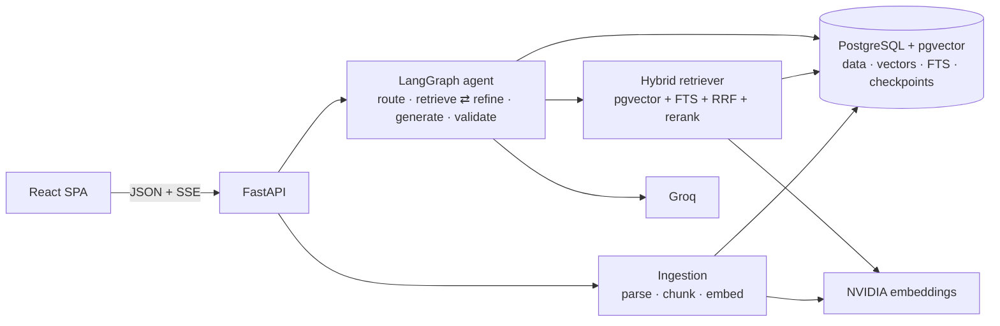

# Atlas AI — Multi-Source Agentic Knowledge Platform

Atlas AI is an enterprise knowledge assistant. You connect documents and web pages, ask
questions across them, and get answers grounded in **validated citations**. When the evidence
isn't there, it says so. A LangGraph agent decides whether to search, refine the search, use a
tool, ask a clarifying question, or abstain. Every run is traced, and a built-in benchmark
measures retrieval and answer quality.

> **Live demo:** not deployed yet. The free-tier deployment (Neon, Render, Vercel) is fully
> prepared; see [docs/deployment.md](docs/deployment.md). A URL will be added here once it has
> been verified.

## Why it is more than a chatbot

- **Grounded by construction.**
  - Every citation must point to a passage retrieved for that answer.
  - Links that don't belong to a retrieved source are stripped.
  - Each sentence is labelled as source-supported or general context.
  - Unsupported answers become an explicit abstention: *"I could not find sufficient evidence
    in your connected knowledge sources to answer this reliably."*
- **Explicit agent.**
  - A typed LangGraph state machine with conditional routing.
  - Bounded retrieval retries and a hard budget on LLM calls.
  - Tools for calculation, document metadata and summarizing a named document.
  - Short-term memory kept in a PostgreSQL checkpointer.
- **Hybrid retrieval in one database.**
  - pgvector HNSW (dense) plus PostgreSQL full-text search (lexical, `ts_rank_cd`; not BM25),
    fused with Reciprocal Rank Fusion.
  - Optional cross-encoder reranking.
  - Every query is filtered by tenant inside SQL.
- **Multi-tenant and defensive.**
  - JWT auth with membership re-checked on every request; roles; and 404 (not 403) for other
    tenants' objects.
  - Protection against fetching internal addresses during URL ingestion.
  - Parser limits against oversized and decompression-bomb files.
  - Layered prompt-injection defences, rate limits, an audit log, and secret redaction in logs.
- **Measured.**
  - A version-controlled 60-question benchmark across 9 categories, comparing four retrieval
    modes on identical labels.
  - Answer metrics are deterministic (no LLM judge), and the results below come from real runs.

## How it compares

Hosted assistants (ChatGPT with files, NotebookLM, enterprise search products) and open-source
RAG platforms already let you chat with documents, and many cite sources. Atlas AI is not trying
to out-feature them. It focuses on the parts that decide whether an organization can **trust,
audit, and adapt** such a system:

| Concern | Typical approach | Atlas AI |
|---|---|---|
| Citations | Generated by the model | **Validated in code**: every marker must reference a passage retrieved for that answer; fabricated sources and foreign links are removed; unsupported answers become an explicit abstention |
| "Is it any good?" | Demos and anecdotes | **Measured**: a version-controlled 60-case benchmark comparing four retrieval strategies on identical labels, with negative results (the reranker hurt) and error analysis published |
| Debugging a bad answer | Black box | **Run inspector**: executed agent steps, each retrieval attempt with per-passage scores, the sufficiency verdict, provider/model, tokens, and which fallbacks were skipped |
| Prompt injection | Usually untested | **Tested**: a poisoned document in the benchmark; injected content appeared in 0 of 60 answers |
| Multi-tenancy | Often app-level filtering | **Inside every SQL query**, with tests using forged tokens, deactivated users, and cross-tenant IDs |
| Model choice | One vendor | **Provider-agnostic chain** (Groq → Gemini → OpenRouter free → NVIDIA), with every model verified by a live call and paid OpenRouter models blocked at startup |
| Data ownership | Vendor-hosted | Self-hostable: one Docker image plus PostgreSQL; no vendor-specific vector store |

It is a portfolio-scale system: a small benchmark corpus, single-instance deployment, and free
model tiers. See [Known limitations](#known-limitations).

## Results (real runs, 2026-10-24)

Benchmark `atlas-handbook-v1` v1.0.1: 11 documents, 60 cases. Embeddings: NVIDIA
`nemotron-3.5-embed-1b`@1024. LLM: Groq `openai/gpt-oss-120b`. k = 5.

| Retrieval mode | Recall@5 | MRR | nDCG@5 | p50 |
|---|---|---|---|---|
| dense | 1.000 | **0.949** | **0.961** | 537 ms |
| lexical (PostgreSQL FTS) | 0.918 | 0.777 | 0.801 | 25 ms |
| hybrid (RRF) | 1.000 | 0.905 | 0.923 | 599 ms |
| hybrid + local MiniLM rerank | 1.000 | 0.871 | 0.902 | 2,068 ms |

**Answers (hybrid retrieval):**

| Metric | Result |
|---|---|
| Correctness | **0.967** |
| Completeness | 0.980 |
| Citation precision | **0.990** |
| Abstention accuracy | **0.967** (all 8 unanswerable questions declined) |
| Injected-content rate | **0.000** (a poisoned document never steered an answer) |
| End-to-end latency | p50 1.46 s · p95 4.0 s |

What these numbers mean, honestly:
- The corpus is small, so recall saturates; MRR and nDCG are the discriminating metrics.
- The small reranker **hurt** ranking here, so it is off by default.
- Thresholds were calibrated on this same set, and each configuration was run once.
- Full analysis, including error analysis, is in
  [docs/retrieval-and-evaluation.md](docs/retrieval-and-evaluation.md) and the
  [case study](docs/case-study.md). Raw results are in
  [`backend/eval/results/`](backend/eval/results/atlas-handbook-v1/).

## Architecture



Details:
- [Architecture, lifecycles, schema, free-tier assessment](docs/architecture.md)
- [Agent workflow](docs/agent-workflow.md)
- [Security](docs/security.md)
- [Troubleshooting](docs/troubleshooting.md)
- [Decision records](docs/adr/)

## Features

- **Knowledge sources:** collections; upload of PDF, DOCX, TXT, Markdown, HTML, CSV and JSON;
  pasted text; public URLs. Ingestion runs asynchronously with status and polling; failed jobs
  can be retried idempotently; duplicates are detected by content hash. Scanned PDFs are
  flagged *needs OCR*. Deletion cascades to chunks and vectors, and re-embedding is supported
  when the model changes.
- **Chat:**
  - Streaming over SSE, Markdown and code rendering, clickable citations.
  - An evidence panel with every retrieved passage and its dense, lexical, fused and rerank
    scores, with warnings on suspicious passages.
  - Provider and model badge, thumbs up/down, conversation history that survives restarts, and
    a link from each answer to its run trace.
- **Run inspector:** node timeline with per-stage latency, each retrieval attempt (query,
  sufficiency verdict, per-chunk scores), token usage, and the error category.
- **Evaluation dashboard:** start benchmark runs from the UI, compare modes on a chart, see
  per-category breakdowns and per-case results.
- **Settings:** workspace retrieval mode, top-k, chunking and model choice, kept separate from
  read-only server configuration. Secrets are never shown.

## Tech stack

| Area | Stack |
|---|---|
| Backend | Python 3.12, FastAPI, Pydantic v2, SQLAlchemy 2.1 (async) + psycopg 3, Alembic, LangGraph 1.2, structlog, optional OpenTelemetry and LangSmith |
| Database | PostgreSQL 17 + pgvector 0.8 |
| Frontend | React 19, TypeScript (strict), Vite, Tailwind 4, TanStack Query, Recharts, react-markdown, Radix primitives |
| Quality | pytest (unit + integration against real PostgreSQL), Ruff, mypy `--strict`, Vitest + Testing Library, Playwright, ESLint |
| Delivery | uv lockfile, multi-stage non-root Docker images, Docker Compose, GitHub Actions, Render blueprint, Vercel config |

## Run it locally

**Prerequisites:** Docker; for development, also Python 3.12 + [uv](https://docs.astral.sh/uv/)
and Node 24.

```bash
cp .env.example backend/.env          # add GROQ_API_KEY and NVIDIA_API_KEY, or set LLM_PROVIDER=mock and EMBEDDING_PROVIDER=mock
docker compose up -d --build          # db → migrate → backend (:8000) → frontend (:5173)
open http://localhost:5173            # register a workspace, or seed the demo:
docker compose exec backend python -m app.cli seed-demo --password "choose-a-demo-password"
```

**Without any API keys:** set `LLM_PROVIDER=mock`, `EMBEDDING_PROVIDER=mock` and
`DEMO_MODE=true`. The deterministic mock providers answer extractively from your documents and
are labelled "demo / mock" in the UI.

**Development servers:**

```bash
docker compose up -d db
cd backend && uv sync && uv run python -m app.cli migrate
uv run uvicorn --factory app.main:create_app --reload --port 8000   # Windows: add --loop asyncio:SelectorEventLoop
cd ../frontend && npm ci && npm run dev                              # http://localhost:5173
```

## Configuration

All variables are documented in [.env.example](.env.example) and `backend/app/core/config.py`.
The important ones:

| Variable | Default | Notes |
|---|---|---|
| `DATABASE_URL` | local Compose DB | `postgresql+psycopg://…` |
| `LLM_PROVIDER` / `LLM_MODEL` | `groq` / `openai/gpt-oss-120b` | `groq`, `nvidia`, `gemini`, `openrouter`, or `mock` |
| `EMBEDDING_PROVIDER` / `EMBEDDING_MODEL` / `EMBEDDING_DIMENSION` | `nvidia` / `nvidia/nemotron-3.5-embed-1b` / `1024` | `mock` for offline use |
| `RERANKER_PROVIDER` / `RERANKER_MODEL` | `none` | `local` (needs `uv sync --extra rerank-local`), `nvidia`, or `mock` |
| `RETRIEVAL_MODE`, `RETRIEVAL_TOP_K` | `hybrid`, `6` | Workspaces can override these in Settings |
| `AGENT_MAX_RETRIEVAL_ATTEMPTS`, `AGENT_MAX_LLM_CALLS` | `2`, `4` | Hard per-request budgets |
| `JWT_SECRET` | random in development | Required (≥ 32 characters) in production |
| `LLM_FALLBACK_CHAIN` | `[]` | Ordered `"provider:model"` fallbacks (one account per provider) used on rate limits, outages, timeouts, unavailable models, or empty answers. OpenRouter entries must be `:free` or the server refuses to start |
| `GEMINI_API_KEY`, `OPENROUTER_API_KEY` | — | Only needed when Gemini/OpenRouter are in the chain |

## Tests and checks

```bash
cd backend
uv run pytest                      # 234 tests; integration tests need `docker compose up -d db` (they are reported as skipped otherwise)
uv run ruff check . && uv run ruff format --check . && uv run mypy
cd ../frontend
npm run lint && npm run typecheck && npm test && npm run build
npm run e2e                        # Playwright journey (needs a backend on :8001 with mock providers; see frontend/README.md)
```

No routine test calls an external API. CI (`.github/workflows/ci.yml`) runs all of the above,
plus migrations, an offline benchmark smoke test, `pip-audit`, `npm audit`, gitleaks and Docker
builds, without any secrets.

## Evaluation

```bash
cd backend
uv run python -m app.cli evaluate --modes all --mock                         # offline and deterministic
uv run python -m app.cli evaluate --modes all --reranker local               # real embeddings, all 4 modes
uv run python -m app.cli evaluate --modes hybrid --answers --pause 4         # plus Groq answers (~50k tokens)
```

Results go to PostgreSQL and to `backend/eval/results/<dataset>/<timestamp>.{json,md}`.

## API

OpenAPI docs are served at `/docs`, and a snapshot is in [docs/openapi.json](docs/openapi.json).
Main resources under `/api/v1`: `auth`, `dashboard`, `collections`, `documents` (upload, text,
url, retry, chunks), `chunks`, `search`, `chat` and `chat/stream` (SSE), `conversations`,
`feedback`, `runs`, `evaluations`, `settings`, `workspace`. Health probes: `/health/live` and
`/health/ready`. Errors always come back as
`{"error": {"code", "message", "request_id", "details?"}}`.

## Security

See [docs/security.md](docs/security.md) for what is implemented and tested, and for the known
gaps. Those gaps include: no password reset, MFA or invitations; tokens stored in
`localStorage`; in-process rate limits; prompt-injection defences that are layered heuristics,
not proofs.

## Known limitations

- The benchmark corpus is small (recall saturates). Thresholds were calibrated on the
  evaluation set, and each configuration was run once.
- No OCR.
- Ingestion runs in-process (interrupted jobs are recovered as retryable failures, but there
  is no durable queue).
- Single-instance assumptions: the rate limiter, the per-conversation lock and job recovery.
- Free-tier limits: Groq's 8k tokens/minute per model, mitigated by a fallback chain across
  Groq (two models), Gemini, OpenRouter free models and NVIDIA; Render's cold start of about a
  minute after 15 minutes idle.
- NVIDIA hosted rerankers are unavailable on the account used, so the working reranker is a
  local CPU model.

## Screenshots

To be added from the deployed app. The Playwright visual spec can capture them:
`E2E_SCREENSHOTS=1 npx playwright test e2e/visual.spec.ts`.

## Future work

- Durable job queue for ingestion.
- Stronger or domain-tuned reranker.
- OCR.
- Invitations and SSO.
- A held-out evaluation split and repeated runs with confidence intervals.
- Entailment-based faithfulness scoring.
- Redis-backed rate limits for multiple replicas.
