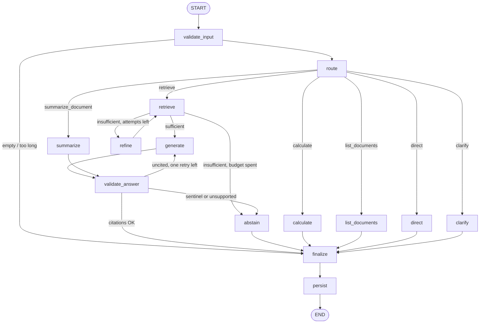

# Agent workflow (LangGraph)

Source: [`backend/app/agent/`](../backend/app/agent/). The graph is defined in `graph.py`, typed state and
run context in `state.py`, rule-based routing in `routing.py`, prompts in `prompts.py`, citation
validation in `citations.py`, and tools in `tools.py`.

## Graph

Every node is wrapped by `traced()`. It records `{node, status, latency_ms, …}` into the run trace,
emits `step` events for the SSE stream, opens an OpenTelemetry span (a no-op unless OTel is
enabled), and turns any provider failure into a categorized error. That error still flows through
`finalize → persist`, so failed runs are stored and visible in the run inspector.

## State and memory

`AgentState` (TypedDict) is checkpointed per conversation by LangGraph's **PostgreSQL**
checkpointer (`thread_id = conversation_id`). Only `turns`, a bounded list of the last 20
user/assistant messages, carries over between runs; it is the short-term memory used to resolve
follow-ups. Every other field is per-run and is reset by `validate_input`. Long-term records
(conversations, messages, runs) live in the application tables.

`AgentContext` holds per-run dependencies: the chat provider, retriever, budgets, and
tenant-bound callbacks. It is injected through LangGraph's runtime context and never
checkpointed, so no provider client or DB handle is serialized.

## Routing

1. **Rules first** (`rule_based_route`): pure arithmetic → `calculate`; greetings → `direct`
   (fixed reply, no LLM call); "which documents do I have" → `list_documents`; "summarize X" →
   `summarize_document`; a short message that leans on a pronoun with no history → `clarify`;
   anything else on the first turn → `retrieve` with the question as the query.
2. **LLM router** for likely follow-ups (there is history and the message is short or refers
   back). It returns JSON validated by Pydantic (`RouteDecision`) and rewrites the follow-up into
   a standalone search query using the history. Malformed JSON falls back to a plain retrieval.
   A provider error **degrades** to plain retrieval instead of failing the run.

Rules exist because Groq's free tier allows 8,000 tokens per minute: spending a routing call on
"hello" or "2+2" would waste the budget meant for answers.

## Budgets and bounded loops

| Budget | Setting | Default |
|---|---|---|
| Retrieval attempts per run | `AGENT_MAX_RETRIEVAL_ATTEMPTS` | 2 |
| LLM calls per run (router, refine, generate, retry) | `AGENT_MAX_LLM_CALLS` | 4 |
| Citation regenerations | fixed | 1 |
| Wall-clock timeout per run | `AGENT_TIMEOUT_SECONDS` | 90 s |
| Graph recursion limit | fixed | 50 |

`refine` always keeps one LLM call in reserve for generation. When the budget is short, it
falls back to a keyword query built from the question. Loops cannot run unbounded: the retrieve
⇄ refine cycle ends when `retrieval_attempts` reaches the budget, and generate ⇄ validate allows
exactly one retry.

## Grounding and citations

- Sources are passed as `<source id="S1" title=… page=… section=…>` blocks.
- The system prompt states that source content is **untrusted data**. Tag-like sequences inside
  source text (`</source>`, `<system>`, …) are neutralized, so a document cannot close its own
  block or impersonate a role.
- The model must cite every factual sentence with `[S#]`. If the sources don't contain the answer
  it must reply with the sentinel `INSUFFICIENT_EVIDENCE`.
- `validate_answer`:
  - normalizes citation variants. gpt-oss emits `【S1】`; this was found by the live smoke test.
  - drops markers that point at no retrieved source.
  - removes URLs that are not a retrieved source's URL.
  - labels each sentence as source-supported or general context.
  - rejects answers with no valid citation or with less than 50% supported sentences.
  Rejected answers get one regeneration with an explicit reminder, then abstention.
- Abstention text: *"I could not find sufficient evidence in your connected knowledge sources to
  answer this reliably."*

What validation guarantees: every citation refers to a passage actually retrieved for this
answer, with real titles, pages and sections; no fabricated sources or URLs survive. What it does
**not** guarantee: that a cited passage logically entails the sentence. The offline benchmark
measures that gap (correctness and citation precision against labels); see
[retrieval-and-evaluation.md](retrieval-and-evaluation.md).

## Tools

| Tool | What it does | Safety |
|---|---|---|
| `calculate` | Arithmetic (`+ - * / // % **`, parentheses) | Whitelisted AST walk, never `eval`; exponent ≤ 100, \|result\| ≤ 1e15 |
| `list_documents` | Titles, status, and passage counts in the selected collections | Closure bound to the caller's tenant |
| `summarize_document` | Summary of a named document (first 8 passages), with citations | Same tenant-bound closure; output goes through citation validation |
| search | The hybrid retriever | Always filtered by tenant and collection in SQL |

There is no shell, network, or free-form database tool. The router never sees document text, so
content inside a document cannot trigger a tool.

## Streaming

`POST /api/v1/chat/stream` runs the graph in a background task and relays `custom` stream events
as SSE: `meta`, `step`, `token`, `token_reset`, `final`, `error`, plus `: keep-alive` comments
every 15 s. Tokens are provisional: `final` carries the validated answer, which may differ or be
an abstention. The run keeps a strong reference independent of the HTTP connection, so a client
disconnect does not lose the answer; it is persisted and appears in the conversation history.

## Run telemetry (`agent_runs`)

Each run stores:
- the provider and model, plus the retrieval config;
- the node trace with per-node latency;
- each retrieval attempt (query, chunk ids, dense/lexical/fused/rerank scores, sufficiency
  verdict, timings, warnings);
- LLM call count and token usage reported by the provider;
- the outcome and error category, the route source, and claim-support counts.

It stores no passage text. Messages store citation references only; snippets are fetched live
when history loads, so deleting a document removes its text from conversation views too.
