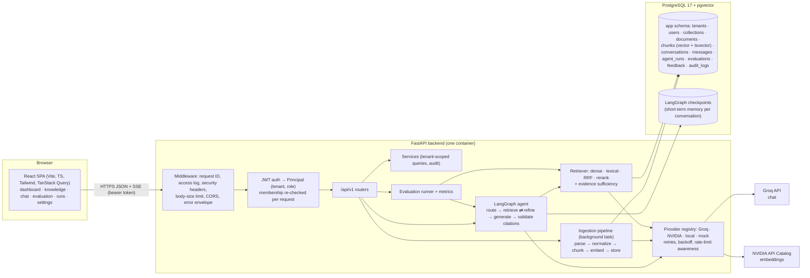
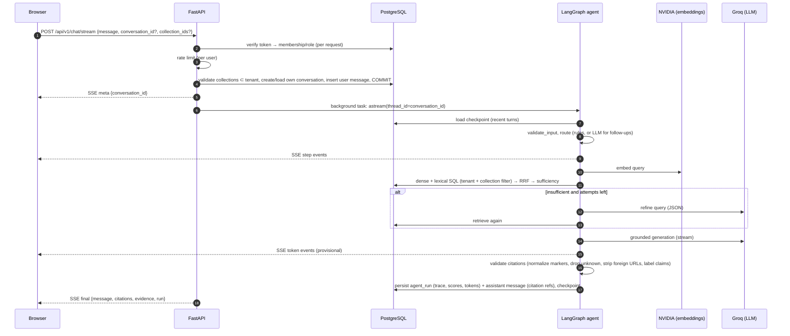
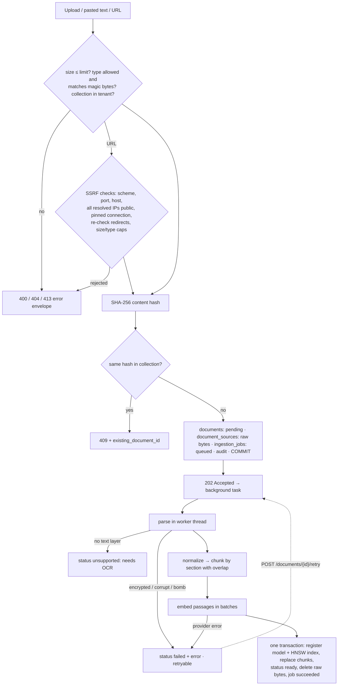
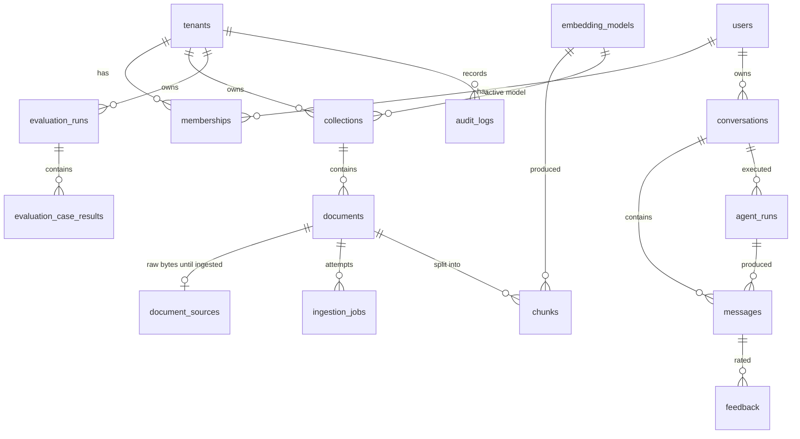

# Atlas AI — Architecture

## 1. System overview



**Design summary:**
- **One backend process and one PostgreSQL database.** PostgreSQL holds relational data,
  vectors (pgvector HNSW), lexical search (`tsvector` + GIN), and agent checkpoints. There is no
  Redis, queue, or separate vector store; deletes are transactional and cascade, so vectors
  cannot be orphaned.
- **Ingestion** runs as in-process background tasks with durable job status (`ingestion_jobs`)
  and restart recovery. A worker would be added only if measured load required it.
- **Layering:** routes stay thin, business logic lives in `app/services`, retrieval in
  `app/retrieval`, providers in `app/providers`, and the agent in `app/agent`. Each part is
  testable on its own: the agent is tested with a canned retriever and scripted chat model, the
  providers with mocked HTTP.

## 2. Repository layout

```
.
├── backend/
│   ├── app/
│   │   ├── main.py                 # create_app(): lifespan (DB, providers, pipeline, agent), middleware, routers
│   │   ├── cli.py                  # migrate · seed-demo · evaluate
│   │   ├── core/                   # config, logging+redaction, middleware, errors, rate limiting, text utils, observability
│   │   ├── auth/security.py        # Argon2 hashing, JWT, Principal + roles
│   │   ├── db/                     # Base/mixins, session, models/ (tenancy, knowledge, conversation, evaluation, audit)
│   │   ├── api/                    # health.py, deps.py, v1/ (auth, dashboard, collections, documents, search, chat, conversations, evaluations, settings, workspace)
│   │   ├── services/               # auth, collections, documents, chat, conversations, embedding_registry, common (scoping, audit)
│   │   ├── ingestion/              # parsers, chunker, url_fetch (SSRF-safe), pipeline
│   │   ├── retrieval/              # search (dense/lexical SQL), fusion (RRF), service (Retriever + sufficiency), types
│   │   ├── providers/              # base (protocols + errors), http (retries), openai_compat, nvidia, local, mock, fallback, factory
│   │   ├── agent/                  # state, graph, routing, prompts, citations, tools, runtime (checkpointer)
│   │   ├── evaluation/             # dataset, metrics, runner, report, cli
│   │   └── demo.py                 # demo workspace seeding
│   ├── migrations/versions/        # 0001 schema · 0002 sources/settings/weighted tsv · 0003 message/run metadata
│   ├── eval/datasets/atlas-handbook-v1/   # 11 documents, 60 labelled cases, manifest
│   ├── eval/results/atlas-handbook-v1/    # benchmark outputs (JSON + Markdown)
│   ├── tests/{unit,integration}
│   ├── Dockerfile, docker-entrypoint.sh
│   └── pyproject.toml, uv.lock
├── frontend/                       # React app (see frontend/README.md)
├── docs/                           # this file, agent-workflow, retrieval-and-evaluation, deployment, security, troubleshooting, case-study, adr/
├── .github/workflows/ci.yml
├── docker-compose.yml              # db · migrate · backend · frontend
└── render.yaml                     # Render blueprint (backend)
```

## 3. Chat request lifecycle



## 4. Ingestion lifecycle



## 5. Database schema



**Key constraints** (all covered by integration tests):
- `tenant_id` is a foreign key on every tenant-owned table, and everything cascades from
  `tenants.id`.
- `(collection_id, content_hash)` is unique, which provides duplicate detection.
- `chunks.tsv` is a generated column: `setweight(section,'A') || setweight(text,'B')`, with a
  GIN index.
- `chunks.embedding` is a dimensionless `vector`, plus `embedding_model_id` and `embedding_dim`.
  `CHECK (vector_dims(embedding) = embedding_dim)` and an all-or-nothing nullability check apply,
  and each model gets a partial HNSW index created at registration (ADR 0004).
- Enum-like columns are `VARCHAR` with a `CHECK` constraint; emails are unique on `lower(email)`.
- `messages.metadata` and `agent_runs.details` hold references and scores, never passage text.

## 6. Technology choices

| Area | Choice | Why | Trade-off |
|---|---|---|---|
| API | FastAPI 0.162 + Pydantic 2.14 | Typed contracts, OpenAPI, async | — |
| DB | SQLAlchemy 2.1 async + psycopg 3.3, Alembic 1.20 | One driver shared with LangGraph's checkpointer; `alembic check` catches model drift in CI | psycopg async needs a selector event loop on Windows (handled) |
| Search | PostgreSQL 17 + pgvector 0.8 HNSW + FTS ([ADR 0001](adr/0001-postgres-pgvector-hybrid.md)) | Single datastore, transactional deletes, filters in the same query | Lexical ranking is `ts_rank_cd`, not BM25 |
| Agent | LangGraph 1.2 `StateGraph` + PostgreSQL checkpointer ([ADR 0002](adr/0002-langgraph-agent.md)) | Explicit nodes and edges, typed state, bounded loops, durable memory | Extra dependency vs. a hand-written loop |
| Providers | Own thin adapters over OpenAI-compatible HTTP ([ADR 0003](adr/0003-provider-abstraction-groq-nvidia.md)) | Full control of retries, rate limits, error mapping; easy to mock | We maintain retry code |
| Chat model | Groq `openai/gpt-oss-120b`, `reasoning_effort=low` | Verified available; fast; low hidden-reasoning token use under 8k TPM | Free-tier TPM limits |
| Embeddings | NVIDIA `nemotron-3.5-embed-1b` @ 1,024 dims | Verified available (other listed embedders returned 404); Matryoshka keeps HNSW-indexable size | One external call per query (~0.5 s) |
| Reranker | Local MiniLM-L6 (optional) ([ADR 0005](adr/0005-local-reranker-fallback.md)) | NVIDIA rerankers retired or not provisioned | Measured to hurt MRR here; off by default |
| Abstention | Lenient retrieval gate + model sentinel + citation validation ([ADR 0006](adr/0006-evidence-gate-and-abstention.md)) | Similarity scores of answerable and unanswerable questions overlap | Depends on the model following instructions |
| Logging | structlog JSON + central redaction | Correlated, safe by default | — |
| Packaging | uv + `uv.lock`; multi-stage, non-root Docker image | Reproducible and fast | — |

## 7. Provider availability (verified 2026-10-24 against this project's keys)

| Capability | Model | Result |
|---|---|---|
| Chat (Groq) | `openai/gpt-oss-120b`, `openai/gpt-oss-20b`, `qwen/qwen3.8-27b` | 200; 8,000 tokens/min and 1,000 requests per window reported in headers |
| Embeddings (NVIDIA) | `nvidia/nemotron-3.5-embed-1b` | 200; 2,048 dims, accepts `dimensions: 1024` |
| Embeddings (NVIDIA) | `nvidia/nemotron-3-embed-1b` | 200 |
| Embeddings (NVIDIA) | `llama-3.2-nv-embedqa-1b-v1`, `nv-embedqa-mistral-7b-v2`, `snowflake/arctic-embed-l` | 404 (listed in catalog, not provisioned) |
| Embeddings (NVIDIA) | `llama-nemotron-embed-vl-1b-v2` | timed out at 60 s |
| Rerank (NVIDIA) | `llama-3.2-nv-rerankqa-1b-v2`, `llama-3.2-nemoretriever-500m-rerank-v2`, `llama-nemotron-rerank-1b-v2` | 410 Gone (end of life) |
| Rerank (NVIDIA) | `nv-rerankqa-mistral-4b-v3` and newer names tried | 404 |
| Chat (Groq) | `openai/gpt-oss-20b` | 200, cited answer, 0.7 s (fallback 1; separate per-model limit) |
| Chat (Gemini, OpenAI-compatible endpoint) | `gemini-3.6-flash` | 200, cited, 1.7 s; accepts `reasoning_effort` (fallback 2) |
| Chat (Gemini) | `gemini-2.5-flash` | 404 "no longer available to new users" (listed but closed) |
| Chat (Gemini) | `gemini-3.7-flash`, `gemini-3.8-flash` | 503 "high demand" / timeouts at probe time |
| Chat (Gemini) | `gemini-3.5-flash-lite` | 200 but wrongly answered `INSUFFICIENT_EVIDENCE` to an answerable question — rejected |
| Chat (OpenRouter free) | `nvidia/nemotron-3-ultra-550b-a55b:free`, `poolside/laguna-s-2.1:free` | 200, cited (fallbacks 3–4) |
| Chat (OpenRouter free) | `google/gemma-4-*:free`, `xing4.0`; `nemotron-3.5-lightning:free`; `inkling*:free` | 429 upstream; empty content; 403 "agentic harnesses only" |
| Chat (NVIDIA) | `nvidia/nemotron-3-ultra-550b-a55b` | 200, cited, 1.3 s (last fallback) |
| Chat (NVIDIA) | `nemotron-3-super-120b-a12b`, `llama-3.1-nemotron-70b-instruct`, `nemotron-nano-3-30b-a3b` | 404 for this account |

**Live findings:**
- Being listed in a catalog does not mean an endpoint is callable.
- gpt-oss writes citations as `【S1】`. The validator normalizes this; it was found during live
  testing, not in mocks.

## 8. Cost and free-tier feasibility

The deployment uses free tiers only (verified limits are in [deployment.md](deployment.md)):
Neon for Postgres with pgvector, a Render free web service for the Docker backend, and a
Render static site for the frontend.
- **LLM and embeddings** run on free API tiers.
- **Typical cost of one question:** about 700–900 prompt tokens and 50–100 completion tokens, one
  embedding call, and 1–3 LLM calls. Measured over 60 benchmark questions: 42,984 prompt and
  4,683 completion tokens.
- **No paid service is configured or used as a fallback.**
- **Main constraints:**
  - Groq's 8,000 tokens/minute, which limits a demo to roughly 8–10 questions per minute.
  - Render spins down after 15 minutes idle, so the first request takes about a minute.
  - The 512 MB / 0.1 CPU instance, so the local reranker stays off in deployment.

## 9. Highest-risk decisions and how they were handled

| Risk | Handling |
|---|---|
| Model or endpoint availability | Probed the real catalog before choosing defaults; mapped 404/410 to `model_unavailable`; reranker fallback (ADR 0005) |
| Free-tier rate limits | Bounded retries honouring `retry-after` / `x-ratelimit-reset-*`; fail fast with a user-facing message when the reset is longer than 20 s; rule-based routing saves LLM calls |
| Embedding dimension drift | Registry + CHECK constraint + per-model index + re-embed endpoint (ADR 0004) |
| Hallucinated citations | Validator guarantees citations reference retrieved passages; abstention path; measured citation precision 0.99 |
| Cross-tenant leakage | Tenant filter inside every SQL statement, including retrieval; 404 for foreign objects; isolation test suite |
| Checkpointer DDL deadlock | `setup()` runs only at startup or via `migrate`, never inside a request (it waited on the request's own transaction during development) |
